# 回声科技 · 产品借用

在上一版产品租借 3D 网站视觉语言上扩展的可管理借用系统。莫兰迪灰绿 / 藕粉、宋体标题、克制留白与柔和阴影继续沿用；新增最多四级可编辑品类、借用人名录、历史补录、外部 GLB 模型库、3D 模型生成、多件借出与批量归还。

> 滚滚小菜鸟 著

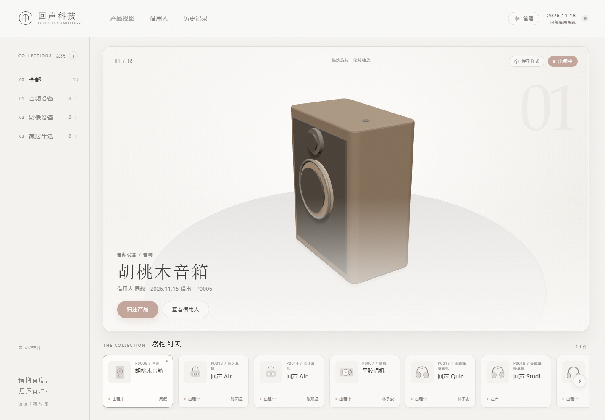


## 功能

- **产品视图**：左侧最多四级品类导航 + 中央 Three.js 3D 展台 + 底部横向器物列表。类目支持单击展开 / 再次单击缩回；器物列表支持左右按钮、触控板横向滑动和 Shift + 滚轮。
- **借用人名录**：独立展示全部借用人（包含当前无借用的人），支持添加、备注和删除；有器物在借时禁止删除，历史流水保留。
- **借用历史**：借用人、四级品类、时间范围、关键词筛选；支持补录已完成的借用记录，并可删除已归还记录，进行中的记录需先归还。
- **多件借出**：一次可勾选多种器物；同款可通过「－ / ＋」一次借出多件，每件生成独立库存与流水。
- **批量归还**：打开任一在借器物，会列出同一借用人的全部在借清单，可勾选多件一起归还。
- **管理控制台**：顶栏「管理」或侧栏「＋」打开抽屉，支持新增 / 改名 / 删除大类与小类，支持一次新增多件同款产品并选择 3D 展示模型。
- **3D 模型工坊**：产品视图右上角「模型样式」按钮，可实时更换中间展台的常用形态、宽高深比例与材质色调，并选择只改当前一件、同名同款全部或整个小类。
- **模型库管理**：可导入外部 `.glb`（单文件 ≤ 15 MB）、预览、删除；可移除未使用的内置模型并在「已移除」中恢复，仍被产品使用的模型会阻止删除。
- **公司原型库**：按 `products.json` 的 40 个产品原型生成 39 个可用 3D 形态并加入模型工坊；可用编号、名称、品类搜索。宽带服务类保留为“无实体”条目。
- **按品类生成模型**：模型库没有合适形态时，输入新品类名（如「电竞椅」「咖啡机」「显示器」），系统按名称匹配并生成模型，未识别时生成可继续调整的通用模型。
- **再借同类**：产品借出后只能归还；若同品类还有在库产品，会显示「再借同类」按钮，可直接为同一借用人再登记一件。
- **安全删除**：删除品类时会保留历史流水；有产品在借时禁止删除；空品类直接删除，含产品品类需二次确认后级联删除。

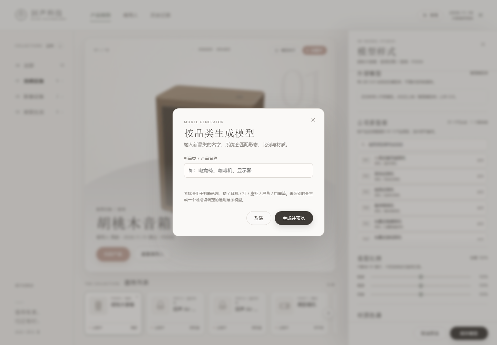

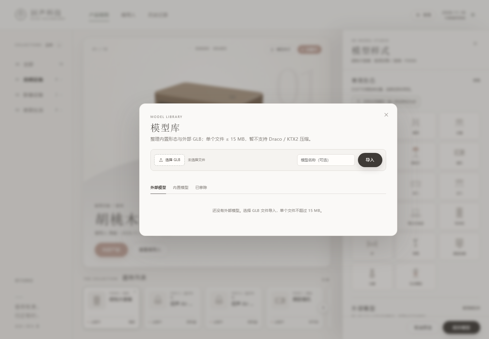

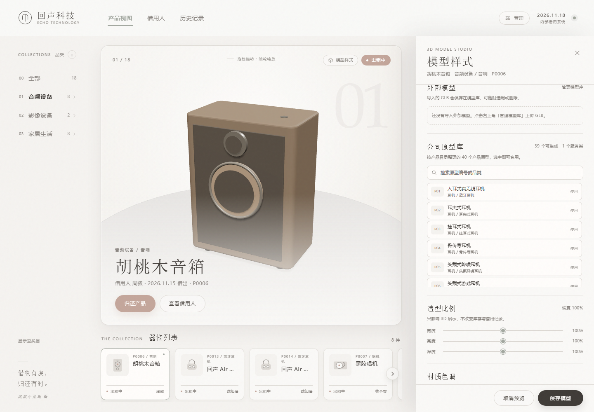

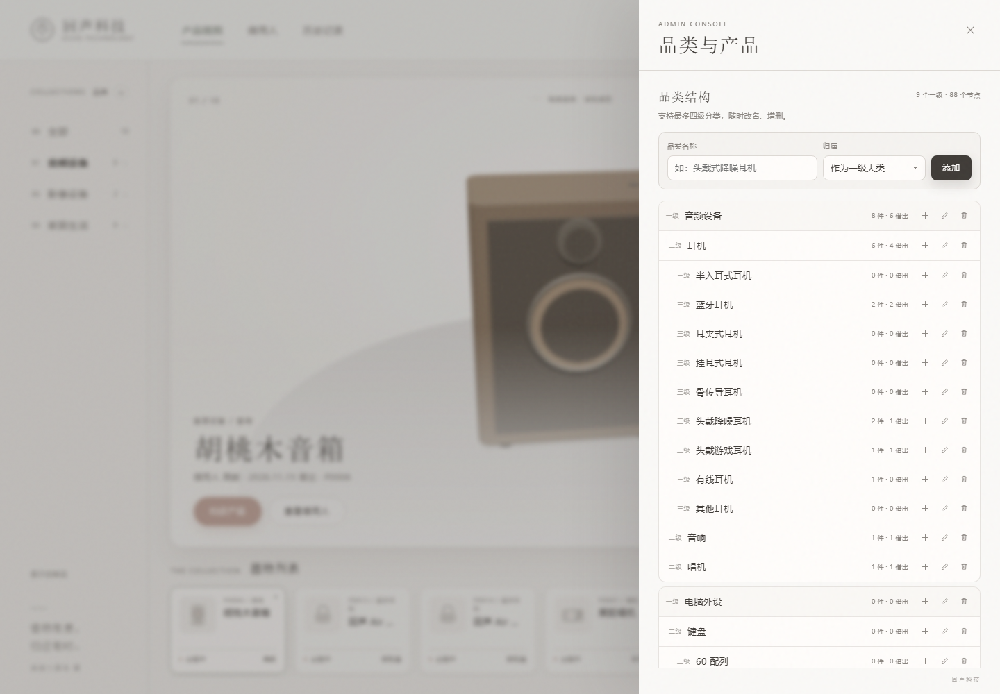

## 启动

```bash
cd "D:\Deep Seek 工作区\公司租借产品网站"
python server.py --port 8000
```

打开 <http://127.0.0.1:8000>。首次启动自动建库并写入：

- 9 个一级大类、39 个二级品类、40 个三级细分（共 88 个品类节点）；
- 18 件可借库存（其中 2 件同款蓝牙耳机、2 件同款降噪耳机）；
- 42 条历史流水，12 件当前在借；

```bash
python server.py --port 8000 --reset        # 重建演示数据库
python server.py --port 8000 --db data/demo.db
```

需要 Python 3.10+；无第三方运行依赖，Three.js 已本地化。

## 页面

| 地址 | 视图 |
| --- | --- |
| `/#products` | 产品视图 |
| `/#borrowers` | 借用人名录 |
| `/#history` | 借用历史 |

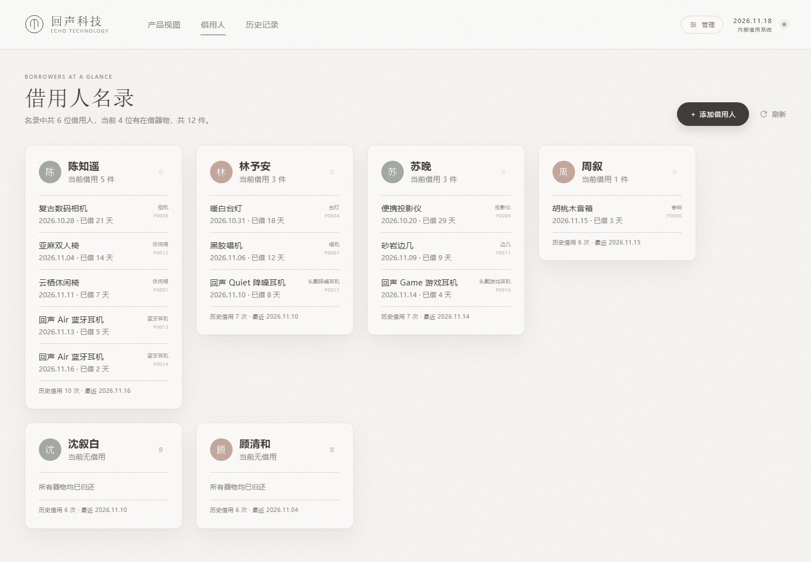

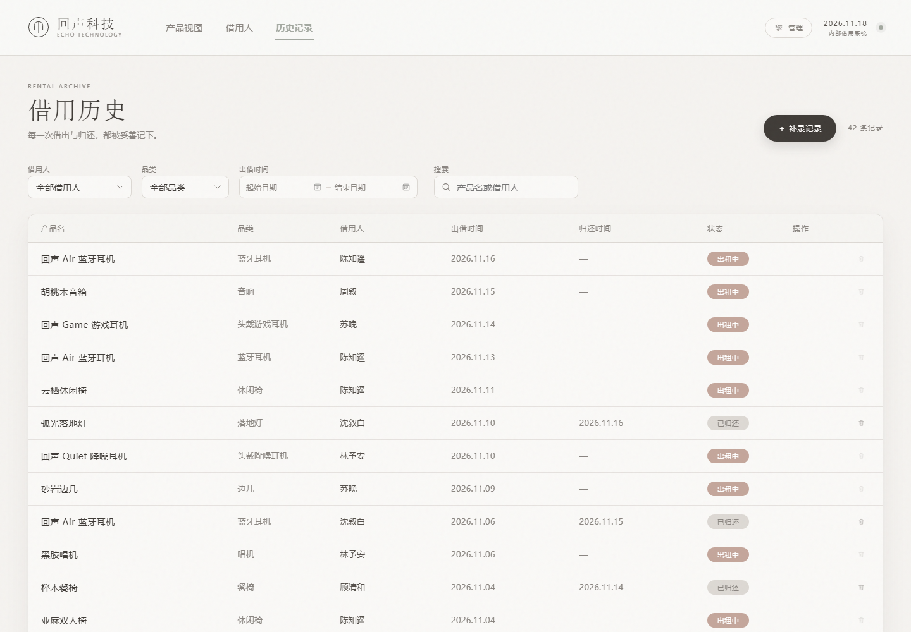

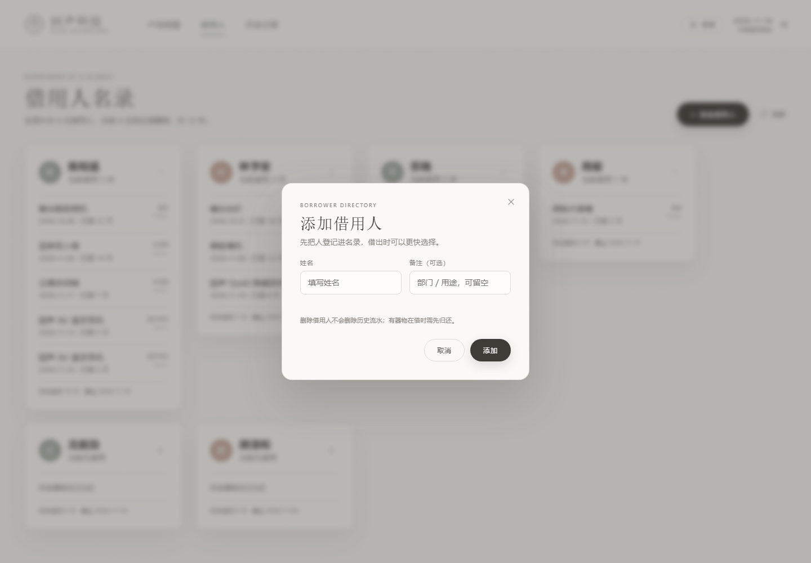

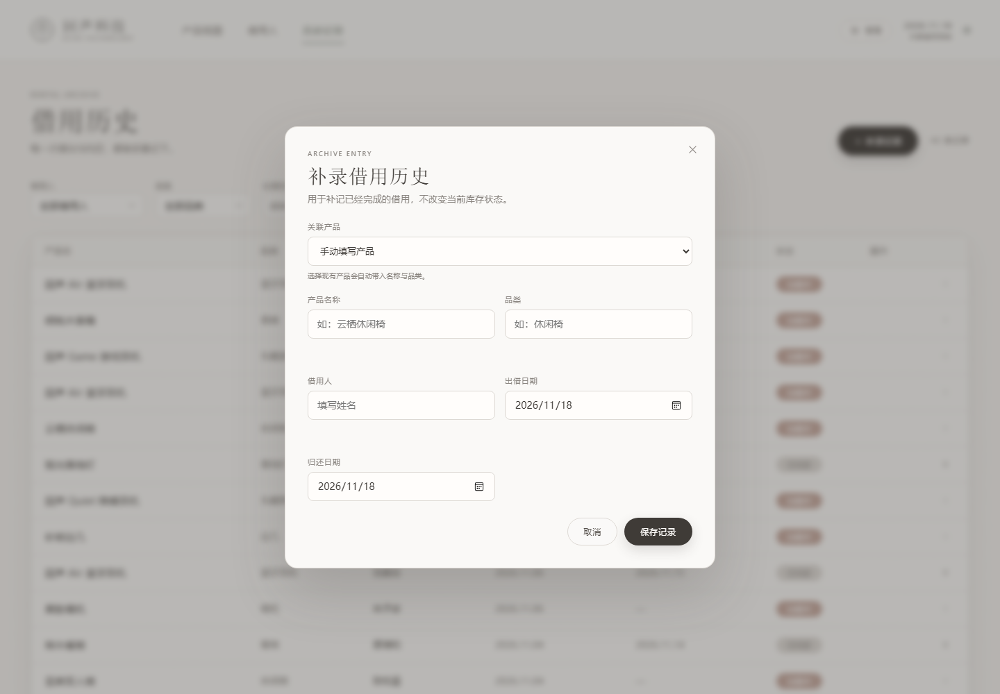

### 最多四级品类示例

```text
耳机
  └─ 蓝牙耳机
      └─ Air 系列
          ├─ 雾灰色
          └─ 米白色
座椅
  ├─ 休闲椅
  ├─ 餐椅
  └─ 坐凳
```

管理抽屉中可为任意未满四级的节点继续添加子级；所有层级都可改名、删除。新增产品必须归入最末级节点。

### 多件借出 / 批量归还

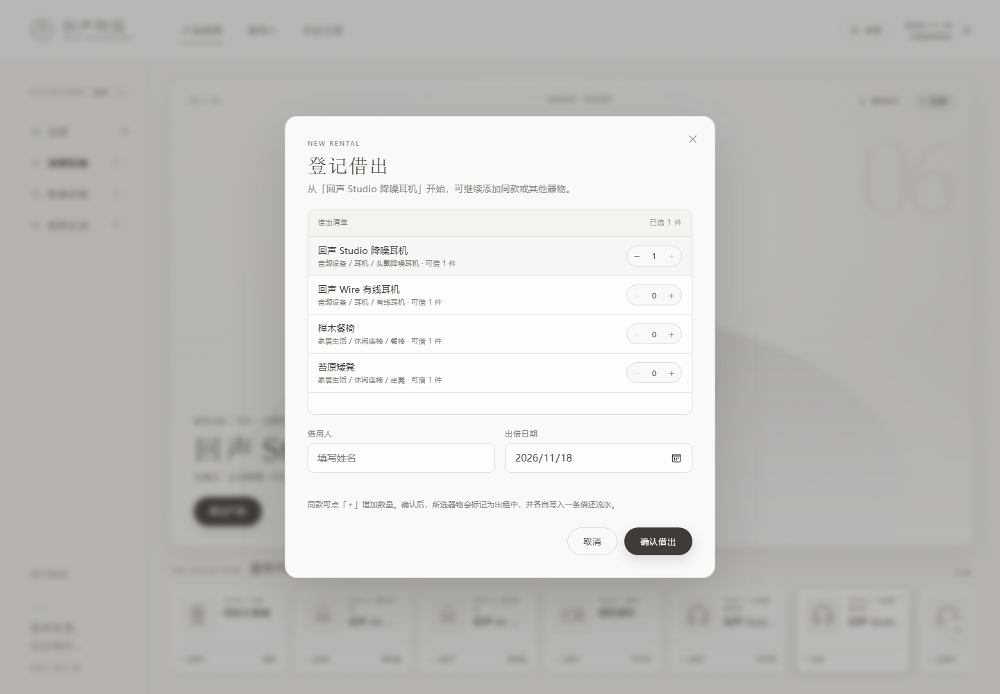

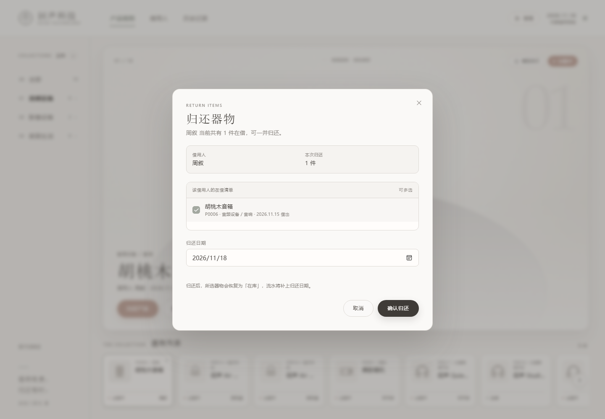

## 数据模型

核心借用状态与流水仍是两张表；为支持管理员自由增删改品类，新增第三张 `categories` 树表。建表与索引见 [`db/schema.sql`](db/schema.sql)。

| categories（最多四级） | 说明 |
| --- | --- |
| `id` | 主键 |
| `parent_id` | 父级 ID；一级为 `NULL`，最多四个层级 |
| `name` | 可修改的品类名 |
| `sort_order` | 同级排序 |

| products（当前状态） | 说明 |
| --- | --- |
| `id` | 主键 |
| `category_id` | 归属小类 ID |
| `category` | 冗余小类名，便于流水快照 |
| `name` | 产品名，可重复（同款多件库存） |
| `model_url` | 3D 模型资源标识 |
| `status` | `in_stock` / `rented` |
| `current_borrower` | 当前借用人 |
| `current_lend_date` | 当前出借日 |

| rental_history（流水） | 说明 |
| --- | --- |
| `id` | 主键 |
| `product_id` | 产品 ID，删除产品时置空 |
| `product_name` | 冗余产品名，保证历史不丢失 |
| `category` | 借出时的小类快照 |
| `borrower` | 借用人 |
| `lend_date` | 出借日期 |
| `return_date` | 归还日期 |
| `status` | `rented` / `returned` |

| borrowers（借用人名录） | 说明 |
| --- | --- |
| `id` | 主键 |
| `name` | 姓名，唯一 |
| `note` | 部门 / 备注，可空 |
| `created_at` | 登记时间 |

| custom_models / hidden_models | 说明 |
| --- | --- |
| `custom_models.model_key` | 外部 GLB 的模型键，写入 `products.model_url` |
| `custom_models.file_name` | 上传文件名，保存在 `public/assets/models/uploads/` |
| `custom_models.size_bytes` | 文件大小 |
| `hidden_models.model_key` | 从模型库移除的内置模型；可恢复 |

约束保证：出租中必有借用人，已归还必有归还日期；同级品类名唯一；品类最多四级。`rental_history.product_id` 使用 `ON DELETE SET NULL`，产品被管理端删除后历史仍然保留。借用人删除不删除历史流水；自定义模型仍被产品使用时拒绝删除。

## API

| Method | Path | 说明 |
| --- | --- | --- |
| `GET` | `/api/products` | 产品列表，附 `category_path`、`asset_code`、`active_rental_id` |
| `GET` | `/api/categories` | 返回最多四级品类树及产品 / 在借数量 |
| `POST` | `/api/categories` | 新增品类，body：`name`, `parent_id`（可空） |
| `PATCH` | `/api/categories/:id` | 品类改名，body：`name` |
| `DELETE` | `/api/categories/:id?cascade=1` | 删除品类；`cascade` 会删除其下产品（有在借产品时拒绝） |
| `POST` | `/api/products` | 新增产品，body：`name`, `category_id`, `quantity`, `model_key` |
| `PATCH` | `/api/products/:id/model` | 更换 3D 模型，body：`model_key`, `scale_x/y/z`, `finish`, `seed`, `scope` |
| `GET` | `/api/borrowers` | 借用人名录，附在借明细与历史次数，按在借件数降序 |
| `POST` | `/api/borrowers` | 添加借用人，body：`name`, `note`（可空） |
| `DELETE` | `/api/borrowers/:id` | 删除借用人；有在借器物时拒绝 |
| `GET` | `/api/history?borrower=&category_id=&from=&to=&q=` | 历史筛选；`category_id` 支持大类或小类 |
| `POST` | `/api/history` | 补录已完成记录，body：`product_id` 或 `product_name`, `category`, `borrower`, `lend_date`, `return_date` |
| `DELETE` | `/api/history/:id` | 删除已归还记录；进行中的记录拒绝 |
| `GET` | `/api/models` | 内置模型、外部模型、已移除模型与使用数量 |
| `POST` | `/api/models/import` | 导入 GLB，body：`name`, `filename`, `data`（base64） |
| `DELETE` | `/api/models/custom/:id` | 删除外部模型；仍被产品使用时拒绝 |
| `POST` | `/api/models/hide` | 从模型库移除未使用的内置模型，body：`key` |
| `POST` | `/api/models/restore` | 恢复已移除的内置模型，body：`key` |
| `POST` | `/api/rentals/batch` | 多件借出，body：`borrower`, `lend_date`, `product_ids` |
| `POST` | `/api/rentals/return-batch` | 批量归还，body：`return_date`, `rental_ids` |
| `POST` | `/api/rentals` | 单件借出（兼容旧接口） |
| `POST` | `/api/rentals/:id/return` | 单件归还（兼容旧接口） |
| `GET` | `/api/health` | 健康检查 |

示例：

```bash
# 一次借出三件产品
curl -X POST http://127.0.0.1:8000/api/rentals/batch \
  -H "Content-Type: application/json" \
  -d '{"borrower":"陈知遥","lend_date":"2026-11-18","product_ids":[2,3,5]}'

# 批量归还两条流水
curl -X POST http://127.0.0.1:8000/api/rentals/return-batch \
  -H "Content-Type: application/json" \
  -d '{"return_date":"2026-11-20","rental_ids":[43,44]}'

# 在「蓝牙耳机」小类下新增两件同款耳机（小类 id 以 /api/categories 实际返回为准）
curl -X POST http://127.0.0.1:8000/api/products \
  -H "Content-Type: application/json" \
  -d '{"name":"回声 Air 2 蓝牙耳机","category_id":4,"quantity":2,"model_key":"wireless-earbuds"}'
```

所有借出 / 归还写操作都在 `BEGIN IMMEDIATE` 事务中完成；批量操作要么全部成功，要么全部回滚。品类改名只影响当前产品展示，流水保留借出时的旧品类快照。

> 当前为内部工具演示，管理入口未接入账号鉴权；正式部署时建议在 `/api/categories`、`/api/products`、`/api/rentals/*` 等写接口前统一加登录与角色校验。

## 代码结构

```text
server.py                  HTTP 服务、SQLite、品类 / 借用人 / 历史 / 模型库 API
db/schema.sql              品类树 + 产品状态 + 借还流水 + 借用人 + 自定义模型
db/company_products.json    公司产品目录原始数据（34 品类 / 613 型号 / 40 原型）
public/index.html          三态视图、管理抽屉、借用人 / 历史 / 模型库弹窗
public/styles.css          莫兰迪视觉系统与响应式
public/app.js              四级品类、借用人名录、历史补录、模型库、筛选分页
public/viewer3d.js         Three.js 场景、56 类程序化模型与外部 GLB 加载
public/vendor/             Three.js、GLTFLoader 本地化文件与 MIT 许可
tests/test_api.py          端到端 API 测试
tests/fixtures/sample_box.glb  外部模型导入测试用 GLB
tools/capture_previews.mjs 本地视觉验收截图脚本
tools/verify_ui.mjs        类目折叠、模型去重与移动端交互验收
tools/verify_features.mjs  滑动、借用人、历史、模型库交互验收
docs/IMPLEMENTATION.md     关键实现说明
```

## 3D 说明

演示模型由 Three.js 程序化构建，`model_url` 的 slug（如 `office-chair.glb`）负责选择模型。当前包含 **56 个程序化形态**，模型工坊中去重展示为 **17 个常用形态 + 39 个公司原型**。公司原型库覆盖 39 个可用原型和 1 个服务类（宽带，无实体）。

产品目录原始数据保存在 [`db/company_products.json`](db/company_products.json)（34 个品类、61 个细分、613 个型号）。系统从中整理出 9 个一级大类、39 个二级品类、40 个三级细分的借用树；613 个型号保留为目录数据，不直接批量生成可借库存，避免把目录型号误当成实际资产。

### 模型工坊

点击产品视图右上角的「模型样式」打开工坊；中央 3D 展台实时预览，不遮挡模型本身。

- **常用形态**：17 种通用程序化模型，已与下方公司原型库去重；
- **公司原型库**：按 `products.json` 的原型编号 P01–P39 生成 39 个可用形态，支持按编号 / 名称 / 品类搜索；P40 宽带标记为“无实体”；
- **外部模型**：通过「管理模型库」上传 `.glb`，使用 GLTFLoader 直接加载；单个文件上限 15 MB，可删除，仍在被产品使用时会被阻止；
- **按品类生成**：点击「没有合适模型？输入新品类名生成」，输入如「电竞椅」「咖啡机」「机械键盘」；系统根据关键词匹配形态，未识别时生成一个可继续调整的通用模型；
- **造型比例**：宽度 / 高度 / 深度 80%–120%，只作用于展示；
- **材质色调**：原色 / 暖木 / 灰绿 / 藕粉 / 石墨，均在莫兰迪色板内；外部模型保留原始材质；
- **应用范围**：仅当前一件、同名同款全部、该小类全部；
- 保存后写入 `PATCH /api/products/:id/model`，变体参数编码在 `model_url` 查询串中，例如：
  `office-chair.glb?sx=1.1&sy=1.04&finish=clay`；通用生成模型还会带 `seed` 用于稳定复现。

`model_url` 同时是未来替换真实 GLB 文件的稳定位置：内置模型走程序化几何，外部模型走 `/assets/models/uploads/` 下的 GLB 文件。

## 验收

```bash
python tests/test_api.py
```

当前结果：9 项测试全部通过，覆盖：

- 种子数据、品类树、产品库存与 42 条流水；
- 借用人名录、在借聚合与同款重复借用；
- 大类 / 小类 / 三级 / 四级历史筛选、日期与关键词筛选；
- 品类新增 / 改名 / 删除 / 级联删除；
- 多件借出、批量归还、单件兼容接口与参数校验；
- 产品删除后历史保留；
- 3D 模型工坊的模型替换、比例 / 色调变体与批量范围；
- 四级品类的深度、路径与级联删除；
- 借用人增删、历史补录 / 删除、外部 GLB 导入 / 删除、内置模型移除 / 恢复。

浏览器验收：三视图、类目单击展开 / 再次单击缩回、空类目显示开关、器物列表左右滑动、借用人添加 / 删除、历史补录 / 删除、模型库 GLB 导入 / 删除、管理抽屉、模型工坊实时预览与保存、同款数量加减、再借同类、批量归还、空状态、移动端无横向页面溢出，控制台无错误。截图位于 [`previews/`](previews/)。

交互回归可运行 `node tools/verify_ui.mjs` 与 `node tools/verify_features.mjs`（需先以 `--remote-debugging-port=9333` 启动 Edge，并通过 `SITE_URL` 指向测试库）。

## 设计令牌

```css
--ink: #3F3B37;
--secondary: #8A8580;
--sage: #A3A8A0;
--clay: #C4A69B;
--line: #DDD9D4;
--paper: #FAF9F7;
--hover: #F5F3F0;
--bg: #F5F3F0;
```

卡片 280px / 24px 间距 / 12px 圆角 / 24px 内边距；筛选控件 36px 高、8px 圆角；表格行 52px；动效统一 200–240ms `cubic-bezier(.22,.61,.36,1)`，并遵循 `prefers-reduced-motion`。

## Cloudflare 线上版（Functions + D1）

线上地址：<https://gg-xiaocainiao.pages.dev>

线上版把 `server.py` 的业务逻辑移植为 Cloudflare Pages Functions（`functions/`），数据保存在 Cloudflare D1，绑定名 `DB`；`public/` 前端与本地版本完全一致。多个同事打开同一网址即可共同登记借出 / 归还，数据持久保存。

- 首次访问会自动建表并写入演示数据（88 个品类节点、18 件库存、42 条流水、6 位借用人）。
- 修改 `server.py` 的种子后执行 `python tools/dump_seed.py` 重新生成 `functions/_seed.js`。
- 线上版暂不支持导入 GLB 模型（`POST /api/models/import` 返回 501），其余功能与本地一致。
- 本地回归：`node tools/test_api_local.mjs`；与 Python 版逐字段对比：`node tools/parity_check.mjs --py http://127.0.0.1:18081 --js http://127.0.0.1:18082`。

### 部署说明

仓库推送到 GitHub 后，Cloudflare Pages 会自动构建发布：

- 构建命令：`npm run build`（占位命令，前端无需构建）
- 构建输出目录：`public`
- D1 绑定：变量名 `DB`、数据库名 `echo-rental`，见 `wrangler.toml`

> 安全提示：当前线上版没有登录校验，拿到网址的人都可以修改数据；建议只在公司内部传播，后续可加简单口令或 Cloudflare Access。

## 如何更新线上网站

线上网站 = GitHub 仓库 `Gg-XIAOCAINIAO/Gg-XIAOCAINIAO` 的 `main` 分支。每次 `git push` 后 Cloudflare 自动构建发布（约 1 分钟），D1 里的业务数据不会重置。

1. **让 DSH 助手改**：把需求说清楚，改完自动提交推送。
2. **GitHub 网页小改**：打开仓库 → 编辑 `README.md` 或 `public/` 下的文件 → Commit changes 到 `main`，等 1 分钟后刷新线上地址。
3. **本机改代码再推送**：仓库在本机的位置是 DSH 工作区里的 `公司租借产品网站` 目录（`D:\工程项目\...` 下的原件不是 git 仓库，改了不会上线）。改完后双击工作区根目录的 `更新网站.cmd`（自动 add/commit/push），或在项目目录执行 `git add -A && git commit -m "说明" && git push`。

- 查看部署：Cloudflare 面板 → Workers 和 Pages → `gg-xiaocainiao` → 部署。
- 回滚：在部署列表里选上一次成功的版本 → 回滚。
- 只改页面上的业务数据（新增/归还/删除记录）不需要发布，直接在网站上操作即可。


